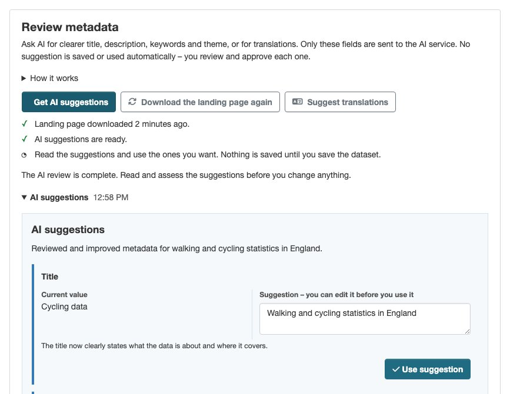
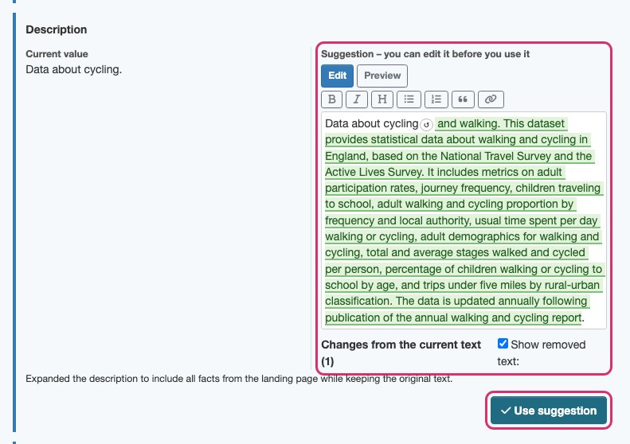
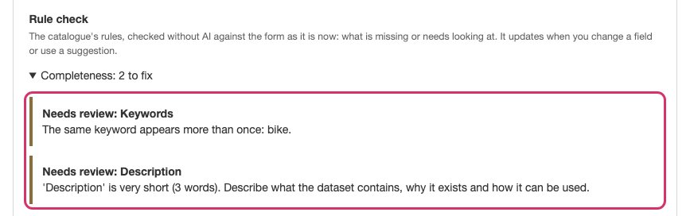
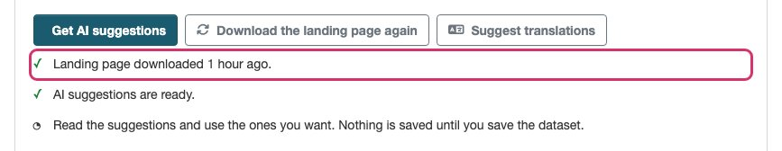
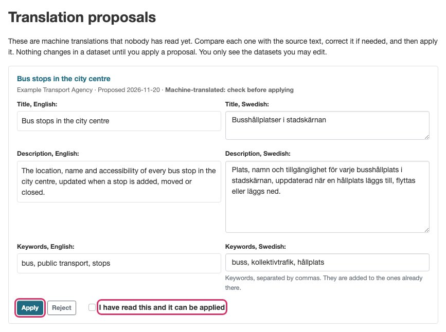
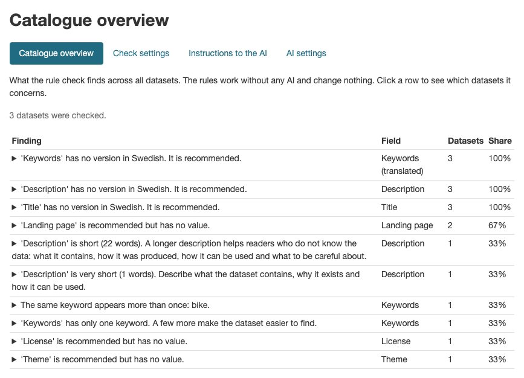

# ckanext-metadata-assistant

A CKAN extension that helps editors write better, more understandable dataset metadata, in every language the portal
publishes in. It checks a dataset against a set of rules and, if you connect an AI service, suggests better titles,
descriptions, keywords and themes, and translates them into the portal's other languages. It never saves or publishes
anything by itself.

> **Status: pre-alpha (`0.2.0`).** It is developed against CKAN 2.12, and its test suite runs on
> CKAN 2.11.1, the newest 2.11 and 2.12. It has not had a formal security audit, and the database schema may still change
> between 0.x releases. The AI connection has been run against Gemini and Claude models; other services reached
> through LiteLLM, and an AI server of your own, have not been tested against real services (see
> [Known limitations](#known-limitations)). Try it on a test installation first.

## What it does

The extension adds a panel to CKAN's dataset edit form and a few administration pages.



- **Rule check, no AI.** Deterministic checks of the dataset: missing required or recommended fields, a theme that is
  not in the vocabulary, a very short description, duplicate keywords, a missing licence, address slips, translations
  that are missing or out of date, and more (see [The rule check](#the-rule-check-1)). It runs in the browser form by
  itself, costs nothing and needs no configuration.
- **Metadata in several languages.** For a multilingual schema, title, description and keywords can be translated into
  each of the schema's languages: in the edit form for one dataset, or for the whole catalogue at once
  (`propose-translations`), with a page where editors go through the proposals. With a translation level set in the
  schema, the rule check reports translations that are missing or older than their source text. The extension brings
  what ckanext-fluent needs for multilingual fields (see [Translation proposals](#translation-proposals) and
  [Multilingual title, description and keywords](#multilingual-title-description-and-keywords)).
- **AI suggestions, optional.** A language model reads the title, description, keywords, theme and, if the dataset has
  one, the landing page, and suggests better versions. Without an AI model configured, only the rule check works.
- **Administration.** For sysadmins: the AI connection and keys, the instructions given to the AI, a catalogue-wide
  overview of what the rules find, and a worker setup for many editors at once.

### The standing principle: an editor approves everything

Every text the AI suggests must be read and applied by a person. This is how the code works:

- The AI actions only *return* suggestions. They never call `package_update`, `package_patch` or any other write.
  The edit form puts a suggestion into a form field when the editor presses *Use suggestion*; the dataset changes
  only when the editor saves the form as usual.
- Translation proposals created in bulk (`ckan metadata-assistant propose-translations`) are stored in the extension's
  own table. A proposal changes a dataset only when an editor opens *Translation proposals*, reads it next to the
  source text and applies it (the text may be edited first). Applying goes through `package_patch` as that editor, so
  the editor's permissions apply, and it is refused if the source text has changed since the proposal was made.
- The only command that writes to datasets without AI is `migrate-multilingual` (see
  [Multilingual fields](#multilingual-title-description-and-keywords)), which copies existing text into the
  multilingual fields and invents nothing.
- The extension also stores AI *results* (not metadata): the latest review per dataset in a cache table, and
  translation proposals. See [Data handling](#data-handling).



## Requirements and compatibility

- **CKAN 2.11 and 2.12.** It is developed against 2.12 and used there; the test suite runs on 2.11.1, the newest 2.11
  and 2.12 (continuous integration). Earlier CKAN versions are not supported.
- **Python 3.10 or newer** (`python_requires` in `setup.py`). It has been run on Python 3.14; other versions have not
  been tested.
- **PostgreSQL**, as required by CKAN: the extension adds two tables.
- **Redis**, which CKAN already requires: used for the background job queue, the limits across workers and the
  landing page cache. Without a reachable Redis the extension still works, runs AI requests inside the web request,
  and applies no limits.
- Installed with the extension: `pydantic>=2,<3` and [ckanext-ai-connector](https://github.com/bjornhagstrom/ckanext-ai-connector) (`>=0.2,<0.4` while
  its API may still change), which holds the AI connection (model, key, time limits, the call itself) that extensions
  share, and brings LiteLLM and `cryptography`. CKAN itself provides the other libraries the code imports (Flask, Click,
  Babel, PyYAML, requests, Redis and RQ). LiteLLM brings many dependencies of its own, so install into a test
  environment first and run `pip check`. The `[ai]` extra is kept for older instructions and adds nothing.
- **The `ai_connector` plugin** must be in `ckan.plugins` for the AI features (the rule check works without it, and the
  setup check says what is missing).
- **Optional, detected at runtime:**
  - [ckanext-scheming](https://github.com/ckan/ckanext-scheming): the rule check reads your dataset schema from it.
    Without it the check uses CKAN's own fields.
  - [ckanext-fluent](https://github.com/ckan/ckanext-fluent): multilingual fields, and so translation suggestions.
  - ckanext-link-check (plugin name `link_check`; not yet on PyPI, install it from a checkout or wheel): adds the latest
    link check results to the review, and enables the optional live address check.
  - `actor_registry`, `data_service_registry` and ckanext-dcat fields (`hvd_category`, `access_services`): only some
    rules look at them, and only if they exist (see the rule table).

## Installation

Install it into the same Python environment as CKAN. It brings ckanext-ai-connector and its libraries:

```console
pip install ckanext-metadata-assistant
```

or from a checkout of the source:

```console
pip install .                # as above
pip install -e .             # editable, for working on the extension
```

The wheel contains everything the extension needs at runtime: templates, JavaScript and CSS (including a bundled
CodeMirror), the compiled Swedish catalogues, the database migrations and the example schema. Nothing has to be
compiled after installing.

Then:

1. Add the plugin to `ckan.plugins` in your CKAN configuration file:

   ```ini
   ckan.plugins = ... metadata_assistant
   ```

   The extension needs no particular position in the list. The only ordering rule it documents is for multilingual
   schemas: `fluent` must come before `scheming_datasets` (see the example schema).

2. Create the extension's tables:

   ```console
   ckan -c /etc/ckan/default/ckan.ini db upgrade -p metadata_assistant
   ```

   The plugin keeps working if the tables are missing (the AI request and the cache check answer instead of failing),
   but the translation proposals page and prepared reviews need them, and the setup check reports the missing tables.

3. Add `ai_connector` (from ckanext-ai-connector) to `ckan.plugins` too, and restart CKAN. Editors now see the review panel
   on the dataset form, and sysadmins find **AI settings** (ckanext-ai-connector) and **Metadata check** in the
   administration area (`/ckan-admin`).

4. Check the setup. This calls no AI service and never shows a key:

   ```console
   ckan -c /etc/ckan/default/ckan.ini metadata-assistant doctor
   ```

   The same list is at the top of the check settings page (`/ckan-admin/metadata-assistant/check`) and is returned by
   the action `metadata_assistant_status`. `doctor` exits with status 1 if any check is an error.

5. To use the AI part, set a model and an API key (see [AI suggestions](#ai-suggestions)). Something not working?
   See [TROUBLESHOOTING.md](TROUBLESHOOTING.md): every message, its cause and what to do.

Without an AI model configured, the panel's rule check works, and the AI step reports that the model is missing from
the configuration.

## Configuration

Set options in the CKAN configuration file, or with CKAN's environment variables (for example
`CKANEXT__METADATA_ASSISTANT__MARKDOWN` for `ckanext.metadata_assistant.markdown`). All options start with
`ckanext.metadata_assistant.`.

Options marked **UI** can also be changed by a sysadmin on the administration pages. A value saved there is stored in
the database with CKAN's `config_option_update`, applies at once in every worker without a restart, and goes before
the server's value. Only values that differ from the server's are saved, and *Use the server's configuration* removes
them. Options not marked **UI** are read from the server's configuration only.

### The rule check

| Option | Default | Meaning |
|---|---|---|
| `profile` | `auto` | Which schema the rule check uses: `auto`, `schema_file`, `scheming` or `ckan_core` (see [Profiles](#profiles-which-schema-is-used)). |
| `schema_file` | none | Path to a ckanext-scheming schema YAML file. The file is read once per process: restart CKAN after changing it. |
| `markdown` (UI) | `auto` | `auto`, `on` or `off`. Whether descriptions are Markdown. `auto` follows the schema (a Markdown form snippet on the description field). Off tells the AI to write plain text and turns any Markdown that comes back into plain text. |
| `check_addresses` (UI) | `off` | `on` lets the panel ask ckanext-link-check about an address the editor has just typed or changed. Needs the `link_check` plugin; has no effect without it. See [Checking the addresses](#checking-the-addresses). |

### The AI connection

The connection (model, key, own AI server, time limits) is set in [ckanext-ai-connector](https://github.com/bjornhagstrom/ckanext-ai-connector), under
`ckanext.ai_connector.*`, and on its page *AI settings* (`/ckan-admin/ai`). The model must be able to answer with structured
JSON (`response_format` of type `json_schema`).

#### Upgrading from the settings this extension had

Up to this release the connection was this extension's, under `ckanext.metadata_assistant.ai_*`. Those names are no
longer read. To move an installation:

1. Install this release and ckanext-ai-connector together, and add `ai_connector` to `ckan.plugins` (before
   `metadata_assistant`).
2. Rename the options in the server's configuration:

   | Old (`.env`) | New |
   |---|---|
   | `CKANEXT__METADATA_ASSISTANT__AI_MODEL` | `CKANEXT__AI_CONNECTOR__MODEL` |
   | `CKANEXT__METADATA_ASSISTANT__AI_API_KEY_ENV` | `CKANEXT__AI_CONNECTOR__API_KEY_ENV` |
   | `CKANEXT__METADATA_ASSISTANT__AI_API_KEY_ENVS` | `CKANEXT__AI_CONNECTOR__API_KEY_ENVS` |
   | `CKANEXT__METADATA_ASSISTANT__AI_API_BASE` | `CKANEXT__AI_CONNECTOR__API_BASE` |
   | `CKANEXT__METADATA_ASSISTANT__AI_TIMEOUT_SECONDS` | `CKANEXT__AI_CONNECTOR__TIMEOUT_SECONDS` |
   | `CKANEXT__METADATA_ASSISTANT__AI_URL_CONTEXT_TIMEOUT_SECONDS` | `CKANEXT__AI_CONNECTOR__PAGE_READ_TIMEOUT_SECONDS` |
   | `CKANEXT__METADATA_ASSISTANT__AI_PROVIDER` | (remove: LiteLLM is the only adapter) |

   In an ini file the same: `ckanext.metadata_assistant.ai_model` becomes `ckanext.ai_connector.model`, and so on.
3. Restart CKAN and run `ckan -c $CKAN_INI metadata-assistant migrate-ai-settings` (first with `--dry-run`) **right away,
   before editors are let in.** Until it has run, the values saved on the old page (a model, a key entered there) are not
   used: with a complete set on the server the AI runs on the server's model and key instead, perhaps another service, and
   reviews made then are cached under that model; without one the AI is off, with a notice. The command copies the values
   saved on the old settings page and re-encrypts the keys entered there for ckanext-ai-connector. It prints names only, never
   a value. It copies once: a later run copies nothing again, so a key removed or a value reset on the new page never comes
   back. It also lists options still set under the old names on the server.
4. When the AI works again (*AI settings → Test the connection*), `migrate-ai-settings --remove-old` deletes the old rows
   (it copies nothing, and refuses before the first run).

Until then the setup check on the *Metadata check* page names what still waits.

### The instructions to the AI

| Option | Default | Meaning |
|---|---|---|
| `ai_review_instructions` (UI) | built-in text | The instruction given to the AI for a review, at most 12000 characters. Saved on the *Instructions to the AI* page. |
| `ai_translation_instructions` (UI) | built-in text | The same for a translation. `{source}` and `{target}` are replaced by the language names. |

### Landing pages

| Option | Default | Meaning |
|---|---|---|
| `landing_page_fetch` (UI) | `auto` | Who fetches a dataset's landing page: `auto` (the portal first, then the AI service if the portal cannot read the page), `own` (the portal only), `provider` (the AI service only). See [Landing pages](#landing-pages-1). |
| `read_page_on_open` (UI) | `on` | When an editor opens a dataset that has an https landing page address, read the page in the background so the suggestions come sooner. **This is one AI call for every page not read recently, also when the editor never asks for suggestions.** Set `off` to avoid that, and on a site with few web processes and no worker. |
| `landing_page_cache_hours` | `6` | How long the reading of a page is kept in Redis, per address. `0` turns the cache off. |
| `page_user_agent` | `ckanext-metadata-assistant/1.0 (+<ckan.site_url>)` | The User-Agent the portal sends when it fetches a landing page. |

### Background jobs and limits

| Option | Default | Meaning |
|---|---|---|
| `jobs` | `auto` | `auto` queues an AI request when a worker is listening and otherwise runs it in the web request; `on` always queues; `off` never does. |
| `ai_max_concurrent` | `4` | Most AI calls at the same moment, across all workers. `0` is no limit. |
| `ai_max_per_minute` | `0` | Most AI calls per minute, across all workers. Set it to your provider's tier. `0` is no limit. |
| `ai_max_jobs_per_user` | `3` | Most queued or running requests per user. `0` is no limit. |
| `ai_max_per_user_per_day` | `0` | Most requests per user per day (UTC). `0` is no limit. |
| `ai_retry_pauses` | `5 15 45` | Seconds to wait before each new try after a rate limit or an overloaded service (space or comma separated). Inside a web request there are no pauses. |
| `ai_breaker_failures` | `5` | Failures within a minute that open the circuit breaker. `0` turns the breaker off. |
| `ai_breaker_seconds` | `30` | How long all calls stop while the breaker is open. |
| `ai_slot_wait_seconds` | `120` | How long a worker waits for a free place before giving up. Zero inside a web request. |

The per-user limits apply to queued requests only. The older synchronous actions (`metadata_assistant_ai_review_dataset`
and the others without `job` in the name) bypass all limits.

The extension also reads CKAN's own `ckan.site_url`, `ckan.site_title` (sent to the AI as the catalogue's name) and
`ckan.locale_default` (the metadata language when the schema does not say).

## The rule check



The rule engine (`ckanext.metadata_assistant.rules`) takes a dataset (the shape of `package_show`) and a *profile*
and returns findings: a severity (`error`, `warning` or `info`), a stable code, a message in the page's language and
the field it concerns. It has no network access and changes nothing. Individual rules cannot be switched off; only the
thresholds below can be changed, through the schema.

| Code | Severity | What it says |
|---|---|---|
| `required_field_missing` | error | A field with `required: true` (or `fluent_required_language`) has no value. |
| `recommended_field_missing` | warning | A recommended field has no value. |
| `theme_not_in_vocabulary` | error | A theme value is not one of the schema field's `choices`. |
| `duplicate_keywords` | warning | The same keyword twice. |
| `keywords_not_separated` | warning | A single keyword of five or more words (a phrase typed without commas). |
| `few_keywords` / `many_keywords` | info | Exactly one keyword; more than 15 keywords. |
| `description_repeats_title` | warning | The description equals the title. |
| `description_too_short` | warning | Fewer words than `min_description_words` (default 8). |
| `description_could_be_longer` | info | Fewer words than `description_tip_words` (default 25). |
| `license_info_in_wrong_field` | warning | A well-known licence link (Creative Commons, Open Data Commons, EU licence vocabulary) in the description while the licence field is empty. |
| `license_missing` | warning | No licence, when the schema does not already recommend or require the field. |
| `title_looks_like_a_file_name` | info | A title in capitals, ending in a file extension (`.csv`, `.xls`, `.xlsx`, `.json`, `.zip`, `.shp`, `.xml`, `.geojson`) or containing an underscore. |
| `description_contains_html` | info | HTML tags in a description that is not Markdown. |
| `no_resources` | warning | A saved dataset that lists no resources. Never raised for an unsaved form draft. |
| `translation_missing` | error or info | The source text exists but a target language is missing: an error for a `required` language, information for `recommended`, no finding for `optional`. |
| `translation_outdated` | warning | The source text changed after the translation was last updated. Needs the translation state field (below). |
| `link_has_spaces`, `link_without_scheme` | warning | A space in an address, or an address without `http://` or `https://`. |
| `link_not_secure` | info | A plain `http://` address (not asked of `conforms_to` links). |
| `link_forwards`, `link_broken` | warning | What ckanext-link-check found at its latest run: an address that forwards (with the better address) or does not work. Only with `link_check` installed and only for addresses still in the dataset. |
| `link_forwards_now`, `link_use_https_now`, `link_forwards_unclear`, `link_broken_now` | warning or info | The same from a live check of an address just typed. Only with `check_addresses = on`. |
| `api_without_service` | warning | A distribution that looks like an API (format, address or specification link) but has no data service. Needs a resource field `access_services` in the schema. |
| `service_on_file` | info | A data service on a distribution whose address looks like a plain file. |
| `hvd_licence` | error | A dataset with `hvd_category` set must have the licence CC0 or CC BY 4.0. |
| `hvd_service_without_contact` | error | A dataset with `hvd_category` and a data service needs a contact point for the service. |

The address fields that are checked are `url`, `conforms_to` and `documentation` on the dataset, and `url`,
`access_url`, `download_url`, `conforms_to` and `documentation` on resources. The data service, high-value-dataset
and `access_services` rules follow DCAT-AP conventions as implemented by ckanext-dcat, and only apply if the schema
uses those fields.

The rule check also runs on its own, without a browser: `GET /dataset/<id>/metadata-assistant/review` returns the
findings as JSON, and the action `metadata_assistant_review_dataset` does the same.

### Profiles: which schema is used

The profile is not tied to any particular schema. It is built from a ckanext-scheming schema, and
`ckanext.metadata_assistant.profile` chooses which one:

| Mode | What is used |
|---|---|
| `auto` (default) | The file in `schema_file` if set, else the schema ckanext-scheming has loaded, else `ckan_core`. |
| `schema_file` | The file in `schema_file`. An error that says what is missing if the option is not set. |
| `scheming` | The dataset schema ckanext-scheming has loaded. An error if there is none. |
| `ckan_core` | CKAN's own fields (title, description, tags, licence, source, maintainer, maintainer email), for a portal without a schema. |

What is particular to a catalogue goes in an optional top-level `metadata_assistant:` block in the schema, never in
this extension. All keys are optional:

| Key | Meaning |
|---|---|
| `name` | The profile's name, shown with each finding. |
| `recommended_fields` | Fields that should have a value. Without it: fields with `field_level: recommended`, else `tag_string`, `license_id` and `url` where the schema has them. |
| `theme_field`, `keywords_field`, `license_field`, `title_field`, `description_field` | Which fields play those roles. Defaults: `theme`, `tag_string`, `license_id`, `title`, `notes` where present. |
| `min_description_words`, `description_tip_words` | The thresholds for the two description rules (8 and 25). |
| `guidance_markers` | Strings that end a help text's instruction: what follows is a note for the editor, not for the AI. |
| `translation_source` | Where the translation requirement comes from, shown in findings. |
| `translation_level` | `optional` (default), `recommended` or `required`: how strongly a missing translation is reported for multilingual fields. |
| `markdown` | `true` or `false`: whether descriptions are Markdown. Without it, the description field's form snippet decides. |
| `baseline_guidance` | `false` leaves out the built-in guidance (below) for fields whose help text says nothing. |

The field help texts in the schema are given to the AI as the catalogue's guidelines for each field, so the AI and
the editor work from the same text. For a field without a help text, a short built-in baseline of guidance (written for
any catalogue) is used. When a label or help text is given per language, the one in the page's language is shown to the
editor, and the one in the portal's main language (`ckan.locale_default`) is given to the AI; else English, else the
first one.

Languages for translation are read from the multilingual fields (ckanext-fluent: fields ending in `_translated` with
`form_languages`), or from a schema field that carries `translation_targets`, `source_language`, `target_languages`,
`translation_glossary` and `translation_instructions` (see `rules/profile.py`). Tracking whether a translation is out of
date uses a hidden schema field with the validator `metadata_assistant_translation_state`.

## AI suggestions

The AI part reviews title, description, keywords and theme, and can translate title, description and keywords. A
suggestion's `field` is one of `title`, `notes`, `tag_string` or `theme`. Themes are only chosen from the schema's
list. The AI never decides about confidentiality, personal data, classification, legal basis, licence or whether
something may be published: its instruction says so, and a review adds nothing about the licence.

### Connecting a model

Set a model and an API key in ckanext-ai-connector, either in the server's configuration (`ckanext.ai_connector.model`,
`ckanext.ai_connector.api_key_env`) or on its *AI settings* page (`/ckan-admin/ai`, sysadmins only; the old address
`/ckan-admin/metadata-assistant` leads there). The page also has *Test the connection*, which makes one short call with
the values in the form, without saving them.

The assistant does three kinds of work, and each can have a model of its own: *Metadata review*, *Translation of
metadata* and *Reading landing pages* (the purposes `review`, `translate` and `landing_page`). They are set under *Models
for different purposes* on the same page; a purpose without a model of its own uses the main model. A cheaper model for
translation and a stronger one for the review is a typical choice. Prepared reviews and page readings are kept per model,
so changing a model does not reuse what another model made.

The model field suggests text models from LiteLLM's own catalogue (shipped with the package) for the services whose
key is set; the field stays free text, because the catalogue lags behind new models.

The model's prefix decides what the model can do with a landing page:

| Model prefix | Page handling |
|---|---|
| `gemini/` | The portal's own fetch, or the model reads the page itself; without a stored reading, a review may also hand the model the page (the review's model then reads it, also when *Reading landing pages* has a model of its own). |
| `anthropic/` | The portal's own fetch, or the model reads the page itself (in a call of its own, never inside a review). |
| anything else | The portal's own fetch only. |

Whether a model can read pages is ckanext-ai-connector's `page_read` capability; how it is done (Google's URL Context,
Anthropic's web fetch) is that extension's detail.

### API keys

The keys are ckanext-ai-connector's: where they come from (an environment variable from an allowlist, or entered on its page
and stored encrypted), what the page shows of them and how they are protected is described in its README. This extension
never reads, stores or shows a key.

### Your own AI server

An organisation with its own server (vLLM, Ollama, LM Studio or similar) can use it so that nothing leaves its network:

1. Set the address in the server's configuration: `ckanext.ai_connector.api_base` (or `CKANEXT__AI_CONNECTOR__API_BASE`). It
   cannot be changed in the interface, on purpose: an address a sysadmin could change would receive every key.
2. Write the model with the right LiteLLM prefix on the AI page. For a server that speaks the OpenAI protocol (vLLM,
   LM Studio): `openai/<model name>`, with `/v1` at the end of the address (for example `http://llm.internal:8000/v1`).
   For Ollama: `ollama_chat/<model>` and an address such as `http://host:11434`. For vLLM there is also
   `hosted_vllm/<model>`. Details belong to LiteLLM:
   [OpenAI-compatible servers](https://docs.litellm.ai/docs/providers/openai_compatible),
   [vLLM](https://docs.litellm.ai/docs/providers/vllm) and [Ollama](https://docs.litellm.ai/docs/providers/ollama).
3. `api_key_env` must still be set to a name (the connection refuses an empty name), but **no key is needed** when an
   address is set: a placeholder is sent only when no key is found. A key entered on the AI page is used first, then the
   environment variable that `api_key_env` names; if that variable exists on the server, its value is sent to your own
   AI server. Point `api_key_env` at an unused name (or an empty variable) when your server needs no key. If it wants
   one, enter it on the AI page like any other.
4. The server must be able to answer with structured JSON (`response_format: json_schema`), or the review fails. Not
   every model can, and it cannot be seen in advance: try *Test the connection* and a real review.
5. Your own model has no page fetch of its own: the portal fetches landing pages itself. Pages on an internal network
   are never read (see [Landing pages](#landing-pages-1)).

This has been tested end to end against a simulated OpenAI-compatible server (the address is followed, the model name
is sent without its prefix, a structured answer is requested, no key is needed). It has not been tested against a real
vLLM or Ollama server.

### The instruction to the AI

*Instructions to the AI* (`/ckan-admin/metadata-assistant/instructions`) shows the whole instruction for a review and
for a translation, as plain text a sysadmin can edit. The built-in texts (in English, which the AI follows best) are only
defaults: until something is saved, the default applies (or the server's configuration, if it sets
`ai_review_instructions` or `ai_translation_instructions`). A saved empty text sends no instruction at all. What the
text cannot remove is technical: every request asks for JSON that follows a schema, and carries the material the
instruction refers to (the dataset's texts, each field's help text, the catalogue's and the owner organisation's name,
whether Markdown is allowed, the landing page). The AI answers in the metadata language: the schema's source language,
else `ckan.locale_default`, else English. *Try on a dataset* runs the AI with the texts in the form, without saving
them.

### Landing pages



**Make the landing page a recommended field.** The page is what the AI has most to go on: with it, the suggestions can
say what the data contains, covers and how often it is updated; without it, the AI has only the texts in the form and
mostly asks the editor. Many schemas have the landing page as optional (it is in DCAT-AP), and a form that folds optional
fields away hides it. With ckanext-field-levels, set
`url: recommended` under `dataset:` in the file named by `ckanext.field_levels.file`; in a schema of your own, give the
field `field_level: recommended`. The setup check on the *Check settings* page says when the field is missing, hidden or
optional.

If a dataset has an address in its `url` field and it is a public https address, it can be used as a source of facts.
A page is read once and the reading (a short structured summary, `LandingPageExtract`) is reused: for a few hours
(`landing_page_cache_hours`) and by every later review. Everything on the page is treated as untrusted data and fenced
in the prompt, never as instructions.

- **The portal's own fetch** (`landing_page_fetch` = `auto` or `own`): https only; no address that is not public,
  checked for every hop of a redirect (a name that does not resolve is refused too); at most 5 redirects, 2 MB and 20
  seconds; HTML and text (a response without a content type is also read); no proxy or `.netrc` from the environment; the first 12 000 characters of text are given
  to the AI, and a page with less than 200 characters (it is built in the browser, or is an error page) counts as not
  readable. Then the AI model summarises the text.
- **The AI service's fetch** (`provider`, or `auto` when the portal could not read the page, except for a page that does
  not exist): Gemini's URL Context or Anthropic's web fetch fetch the page on the service's side. Sites sometimes keep
  these fetchers out, which is why the portal's own fetch comes first in `auto`.
- A model with neither capability can only use the portal's own fetch.
- A review request that carries the landing page address but no previous reading lets a `gemini/` model fetch the page
  itself with URL Context, whatever `landing_page_fetch` says; `landing_page_fetch` governs the separate page-reading
  step the form uses before it asks for a review.
- If the reading fails, the review goes on with the form's own text only, and the panel tells the editor that the page
  could not be read.
- A page read ahead of time (`read_page_on_open`) uses only the portal's own fetch, a 30 second model limit, one such
  reading at a time, and a page that failed is not tried again for ten minutes.

### What data leaves the server, and when

Only the following is sent to the AI service, and only when an AI model is configured:

- **A review:** the title, description, keywords and theme values; the list of allowed themes (address and label);
  the language; the help text of the fields the AI suggests for; the name of the dataset's owner organisation and the
  catalogue's name (`ckan.site_title`); whether Markdown is allowed; the codes (not texts) of rule findings the AI may
  take care of; the instruction; and the landing page: the *address* if the service fetches the page itself, otherwise
  the reading of the page.
- **A landing page reading:** with the portal's own fetch, up to 12 000 characters of the page's text; with the
  service's fetch, the address.
- **A translation:** the title, description and keywords, the schema's glossary and instructions for the target
  language, and the instruction.
- **The connection test:** one fixed single word.

Only the fields listed above are sent: never data files, resources or other metadata fields. The text is what the editor
wrote and what the landing page contains; nothing filters it for personal data, so do not enter any. Only the portal's server contacts the AI service; the
editor's browser talks to CKAN only. The portal itself makes an outbound request to a landing page address an editor has
entered (the portal's own fetch, with the protections above). With `ckanext.ai_connector.api_base` set, the AI calls go to your own server
instead of an AI company.

When it happens:

- **When an editor asks:** pressing the AI button, the translation button, or *Get new suggestions*.
- **Automatically in the edit form:** when the editor leaves a field the AI looks at (title, description, keywords,
  theme) and its text has changed since the last review, the panel starts a review by itself, after a short delay.
  Nothing is changed in the form by this; the suggestions appear in the panel.
- **When the form opens**, if `read_page_on_open` is on: the landing page is read.
- **Without an editor present:** `review-all` and `propose-translations` send the datasets' texts to the AI for every
  dataset they process (and `review-all` reads their landing pages). Both are paid calls: start with a small `--limit`.

Every AI call is a paid call at your provider. The limits above, the caches and `--dry-run` options exist to keep that
under control.

### The AI work in code

`ckanext.metadata_assistant.llm.assistant.MetadataAI` asks the shared client (`api.client("metadata_assistant")` of
ckanext-ai-connector) for the review, the translation and the readings of a landing page; its prompts are in `prompts.py` and
the shapes of the answers in `contracts.py`. There is no adapter registry of its own any more: another AI service is
reached through LiteLLM's model names, or through an own server (`api_base`). Failures are raised as `ProviderError`,
`ProviderConfigurationError` or `ProviderResponseError` (ckanext-ai-connector's errors under this extension's names), and
their messages are shown to the editor, so they never contain secrets or request data.

## Many editors at once: background jobs

An AI request takes seconds (a review) to minutes (reading a landing page). Run inside the web request it holds one web
worker for all that time, so a few editors working at once can block the site. With a **job worker**, the web request
only checks access and queues the request, and a separate process does the slow part.

**Without a worker, check the web server's time limit.** CKAN's Docker images run uWSGI with `--harakiri 50`
(`UWSGI_HARAKIRI`), which ends a request after 50 seconds, and a review that reads a landing page can take longer. Raise it
(for example `UWSGI_HARAKIRI=200`) or start a worker.

- **Nothing to configure for a small site.** With `jobs = auto` (default), requests are queued while a worker is
  listening and otherwise run in the web request. Start a worker and requests are queued; stop it and they run in the
  page again. A worker silent for 90 seconds counts as gone. `jobs = on` always queues (and the setup check reports an
  error if no worker is listening); `off` never does.
- The extension cannot start processes itself. Run the worker as a service, with the same code and environment as CKAN
  (it shares CKAN's database and Redis and has no web interface):

  ```console
  ckan -c $CKAN_INI metadata-assistant worker
  ```

  Start as many as your AI service allows at once; `ai_max_concurrent` caps them all. It serves the extension's two
  queues (`metadata_assistant` and `metadata_assistant_bulk`) and must be started with this command: a worker started
  any other way sends its sign of life too rarely to be counted as listening, so `auto` mode would not queue requests
  for it. Restart workers when CKAN is upgraded.
  A Docker Compose service example:

  ```yaml
  metadata-assistant-worker:
    image: <the same image as the ckan service>
    env_file: <the same environment as the ckan service>
    command: ckan -c /srv/app/ckan.ini metadata-assistant worker
    depends_on: [redis, db]
    restart: unless-stopped
  ```

- **Limits across all workers** (Redis): concurrency, calls per minute, jobs per user, requests per user per day, retry
  pauses after a rate limit or an overloaded service, and a circuit breaker (by default 5 failures within a minute stop
  all calls for 30 seconds, and editors get a clear message at once instead of each waiting for a timeout). See the
  options above.
- **One call serves many.** The reading of a landing page is kept per address in Redis. The latest review of each dataset
  is kept in the database (`metadata_assistant_review_cache`) until any of its texts, the guidelines, the instruction or
  the model changes. *Get new suggestions* always makes a new review.
- **Prepared suggestions.** `ckan -c $CKAN_INI metadata-assistant review-all` queues a review for every dataset without a
  current one, on a second queue that workers serve after editors' requests. When an editor opens such a dataset the
  panel shows the prepared suggestions ("Suggestions prepared 10:45") without any AI call. Run it before a training
  session or from cron at night.
- A job's status can be read only by the person who started it and by sysadmins. An answer waits 15 minutes to be
  fetched; a job may run for at most 5 minutes.

## Command line

All commands are `ckan -c $CKAN_INI metadata-assistant <command>`:

| Command | What it does |
|---|---|
| `doctor` | The setup check: database tables, AI model, library and key, schema, guidelines, languages, background work. Calls no AI. Exit status 1 on an error. |
| `worker [--burst]` | Runs queued AI requests. `--burst` stops when the queues are empty. |
| `queue` | The queues, workers listening, calls in progress, limits reached today, breaker state, prepared reviews and the mode. |
| `review-all [--organization X] [--limit N] [--dry-run]` | Queues reviews to have suggestions ready (see above). |
| `propose-translations [--limit N] [--organization X] [--include-outdated] [--dry-run] [--pause S]` | Asks the AI for translation proposals for datasets that lack one (default limit 20, default pause 1 second between requests) and stores them. Nothing is saved to the datasets: editors read each proposal at `/metadata-assistant/translations`. |
| `migrate-multilingual [--dry-run]` | Copies existing title and description into the multilingual fields (see below). |
| `migrate-ai-settings [--dry-run] [--remove-old]` | Copies the AI settings a development version kept under this extension's names to ckanext-ai-connector, once; `--remove-old` then removes the old rows (see "Upgrading from the settings this extension had"). |

## Translation proposals



For a multilingual schema, the editor form can suggest translations of title, description and keywords into the
schema's target languages (one AI request per language, so one that fails does not stop the others). For existing
datasets in bulk, `propose-translations` stores proposals, and editors work through them at
`/metadata-assistant/translations`: they see the proposal next to the source text, may edit it, and apply or reject it
one at a time or tick several. A sysadmin sees all open proposals; others see those of datasets in organizations where
they are editor or admin. A proposal becomes `stale` and cannot be applied if the source text has changed, and a new
proposal replaces an older pending one for the same dataset. There is no command to purge old proposals.

## Multilingual title, description and keywords

The extension provides what ckanext-fluent needs for a field to have several languages, so a portal needs no other
extension for that: the validators `metadata_assistant_fluent_from_core`, `metadata_assistant_fluent_to_core`,
`metadata_assistant_fluent_tags_strip` and `metadata_assistant_fluent_tags_output`, and an empty stand-in for a helper
that ckanext-fluent calls and that only exists in unreleased ckanext-scheming (registered only if scheming has none).
The example schema `ckanext/metadata_assistant/examples/multilingual_migration_schema.yaml` shows it. Note that this
example is built on the schema of ckanext-actor-registry (its publisher and contact point fields) and needs that
extension to load; use it as a reference for the fluent parts (the fields `title_translated`, `notes_translated` and
the validators), not as a starting schema.

Set up: the plugin `fluent` before `scheming_datasets`, fluent's preset file in `scheming.presets`,
`ckan.locale_default` (the default language), and then once, for datasets that already exist:

```console
ckan -c $CKAN_INI metadata-assistant migrate-multilingual --dry-run
ckan -c $CKAN_INI metadata-assistant migrate-multilingual
```

The existing text becomes the default language's version; no other language is invented. This command writes to
datasets and reindexes them, so take a backup first.

## Checking the addresses

The rule check looks at the text of the addresses of a dataset (spaces, a missing `http://` or `https://`, plain
`http://`) without asking the network. When ckanext-link-check is installed it also shows what its latest check found
about each address (an address that forwards, with the better address, or one that does not work).

Optionally the panel checks an address the editor has just typed or changed (`check_addresses = on`, or the same setting
on the *Check settings* page; off by default). The server then requests the address through the link check, which has its
own protection against private networks, for at most three addresses and twelve seconds per review. Addresses the page
opened with are not checked.

## Administration pages



All for sysadmins, under `/ckan-admin/`:

| Page | Address | What it does |
|---|---|---|
| AI settings (ckanext-ai-connector) | `/ckan-admin/ai` | The connection (model, key, time limits), keys and *Test the connection*. `/ckan-admin/metadata-assistant` leads there. |
| Instructions to the AI | `/ckan-admin/metadata-assistant/instructions` | Edit and try the instructions. |
| Check settings | `/ckan-admin/metadata-assistant/check` | The setup check (including the state of background work and the AI connection), Markdown, live address check, how landing pages are read, read-ahead. |
| Catalogue overview | `/ckan-admin/metadata-assistant/overview` | Runs the rules (no AI, no address checks) on every dataset, and shows how many datasets each finding concerns, with the datasets listed. Nothing is changed. |

Other pages: `/metadata-assistant/translations` (signed-in editors) and `/metadata-assistant/help` (a page of text for
editors, public, with no data).

## API actions and access control

Actions are called as `POST /api/3/action/<name>`; those marked GET-able are also available with GET.

| Action | Who | What it does |
|---|---|---|
| `metadata_assistant_review_dataset` (GET-able) | Anyone who may read the dataset (`id`); for an unsaved draft (`dataset`), someone who may edit that dataset or create datasets | The rule findings. Never calls an AI service. Optional `check_addresses` (list of at most three). |
| `metadata_assistant_ai_review_dataset` (GET-able) | Someone who may edit the dataset (`package_update`), or create one for a draft | AI suggestions for title, description, keywords and theme. Optional `landing_page_extract`. Saves nothing. |
| `metadata_assistant_read_landing_page` (GET-able) | As above | Reads the page behind `url` and returns the structured reading, to pass back as `landing_page_extract`. |
| `metadata_assistant_translate_dataset` (GET-able) | As above | Translation suggestions for the schema's target languages (`languages` picks some). Returns `suggestions` and `failed`. |
| `metadata_assistant_job_start` | As above, according to `kind` (`landing`, `review`, `translate`) | Starts the request as a job (or answers at once from a cache, or runs it in the request when no worker listens). Options `fresh`, `cache_only`. Returns `state`: `done`, `queued` (with `job_id` and `position`) or `none`. |
| `metadata_assistant_job_status` (GET-able) | The person who started the job, and sysadmins | `queued`, `running`, `done` (with `result`) or `failed`. |
| `metadata_assistant_render_markdown` (GET-able) | Any signed-in user | The text as the site renders Markdown, for the preview. Stores nothing. |
| `metadata_assistant_status` | Sysadmins | The setup check. Calls no AI. |
| `metadata_assistant_ai_settings_reset` | Sysadmins | Forgets the metadata check's settings saved in the interface (the AI connection's are ckanext-ai-connector's, `ai_connector_reset`). |
| `metadata_assistant_catalogue_overview` (GET-able) | Sysadmins | The catalogue-wide rule counts (optional `limit` of datasets listed per finding, default 50). |

AI actions need edit rights, not just read rights, because they spend the organisation's money and send metadata to a
third party. Sysadmin-only actions use the auth function `metadata_assistant_ai_settings`, which denies everyone except
sysadmins (who pass every CKAN check).

### Data handling

- The extension adds two tables: `metadata_assistant_translation_proposal` (suggested translations until an editor
  decides, with who decided and when) and `metadata_assistant_review_cache` (the latest AI review per dataset, as JSON).
  Both hold AI output derived from dataset texts, including those of private datasets: treat them like the datasets.
  The cache is cleared per dataset when a newer review replaces it; proposals are kept.
- Redis holds job state, limit counters and the landing page readings (keyed by a hash of language and address).
- Encrypted API keys, the names of keys added on the page, and values saved on the admin pages are in CKAN's
  `system_info` table.
- The server log has no request data, dataset text or key; adding and removing a key logs the key's name and the user.
- Check that `ckan.csrf_protection.ignore_extensions` is not set to `true`, so CKAN validates CSRF tokens on the
  extension's forms and API calls from the browser.

## Interface languages

The source texts of the interface are English. The extension ships Swedish catalogues (`sv` and `sv_SE`, identical),
registered through CKAN's `ITranslation`, and CKAN picks the one that matches the visitor's language. The AI's own
texts (prompts, suggestions) are not interface texts and are not translated. The compiled `.mo` files are included, so
there is no build step to use the extension; a site that wants `sv_SE` must list it in `ckan.locales_offered`.

To change or add a string, edit the `.po` file, and compile it. From the extension's directory (Babel and Jinja2
needed):

```console
PYTHONPATH=. pybabel extract -F babel.cfg -o ckanext/metadata_assistant/i18n/ckanext-metadata-assistant.pot .
pybabel compile -d ckanext/metadata_assistant/i18n -D ckanext-metadata-assistant
```

The extraction uses the template tag shims in `babel_ckan_tag_shims.py` (referenced from `babel.cfg`), so CKAN's
``, `` and `` do not make Babel drop a template's strings silently. Both files
are in the source repository only, not in the wheel.

## Known limitations

What does **not** work today, on purpose or not yet, so that nobody has to find out by trying.

- **Pages on an internal network are not read** (an intranet, an internal web server, any address that is not public).
  This is a decision, not an oversight: the portal fetches only public https addresses and checks every hop of a
  redirect, the AI services' own fetch cannot reach your network, and what is read on a page goes to the AI provider.
  The editor sees that the page is not on a public address and the review goes on with the form's texts. This holds with
  an AI server of your own too: the page's text would then stay in your network, but the portal still does not fetch
  internal addresses that an editor types in, or a form field could be used to reach internal services (server-side
  request forgery, SSRF). Not decided and not built: an allowlist of internal host names, or letting the editor paste the
  text of the page. Pages that need a login are not read at all.
- **The check that an address is public is made before the request**, with a separate name lookup for the request itself.
  A name that resolves differently at the two moments (DNS rebinding) is not excluded. Only editors can supply the
  addresses.
- **Pages that build their content in the browser with JavaScript** cannot be read by the portal's own fetch.
- **An AI server of your own** is set in the server's configuration only, has no field in the interface, and is tested
  only against a simulated server (see above).
- **Models for a key you add yourself** have to be typed in the model box; they are not offered in the list.
- **Only Gemini and Claude models have been tested.** Many other services are reachable through LiteLLM (in
  ckanext-ai-connector); none of them has been tested against the real service.
- **The AI suggests only for `title`, `notes`, `tag_string` and `theme`.** Other fields get rules, not suggestions.
- **Individual rules cannot be switched off**, and the keyword limit (15) is fixed.
- **No purge command** for translation proposals or the review cache table.
- **Pre-alpha:** the interface texts, options and the database schema may change between 0.x releases.

## Testing

Part of the suite runs without CKAN; the rest needs a CKAN test environment.

**Without CKAN.** Install `pydantic` and ckanext-ai-connector (`pip install pydantic ckanext-ai-connector`; its testing
helpers stand in for the AI service), then from the extension's directory:

```console
python -m unittest ckanext.metadata_assistant.tests.test_rules ckanext.metadata_assistant.tests.test_profiles ckanext.metadata_assistant.tests.test_llm
```

These cover the rule engine, the profile builder and the AI calls with a fake model, and need no CKAN, database or
network. The JavaScript tests of the panel use Node's built-in test runner and have no other dependency:

```console
node --test ckanext/metadata_assistant/tests/js/test_review.js
```

**The full suite** uses pytest and needs a CKAN source or development environment with CKAN's test database and Solr,
because the integration tests use CKAN's plugin fixtures. Redis is needed too: the job and limit tests use Redis
database 3 on the host from `CKAN_REDIS_URL` (default `redis://redis:6379/1`), and skip themselves if Redis cannot be
reached. The i18n test also needs Babel and Jinja2, and reads `babel.cfg`.

1. Install CKAN (2.12 recommended) with its development requirements (which provide the pytest plugin), and the
   extension in editable mode (`pip install -e .`, which brings ckanext-ai-connector), in the same environment.
2. Make `test.ini` point at your CKAN's test configuration. Its `use =` line is `config:../../src/ckan/test-core.ini`,
   a path relative to the file that fits only one directory layout; change it to the real path of CKAN's
   `test-core.ini`. Make sure the test database and Solr that file names exist (see CKAN's own testing documentation).
3. From the extension's directory:

   ```console
   pytest --ckan-ini=test.ini ckanext/metadata_assistant/tests
   ```

Do not run the tests against a database or a Solr index that holds data you want to keep: CKAN's test setup resets what
it is pointed at.

The wheel includes the Python tests, but not `test.ini`, `babel.cfg`, `babel_ckan_tag_shims.py` or the JavaScript tests.
Run the tests from a source checkout.

## Changelog

See [CHANGELOG.md](CHANGELOG.md).

## License

MIT. See [LICENSE](LICENSE).
